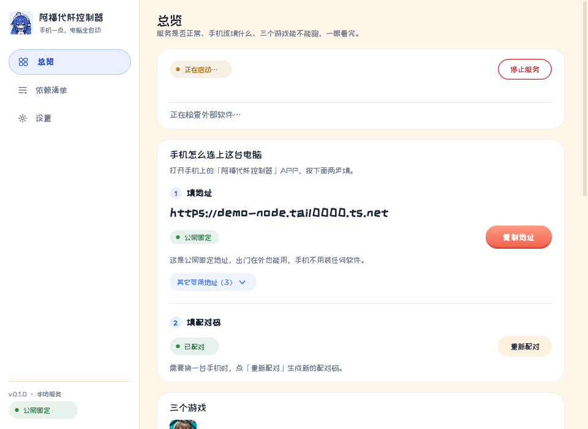
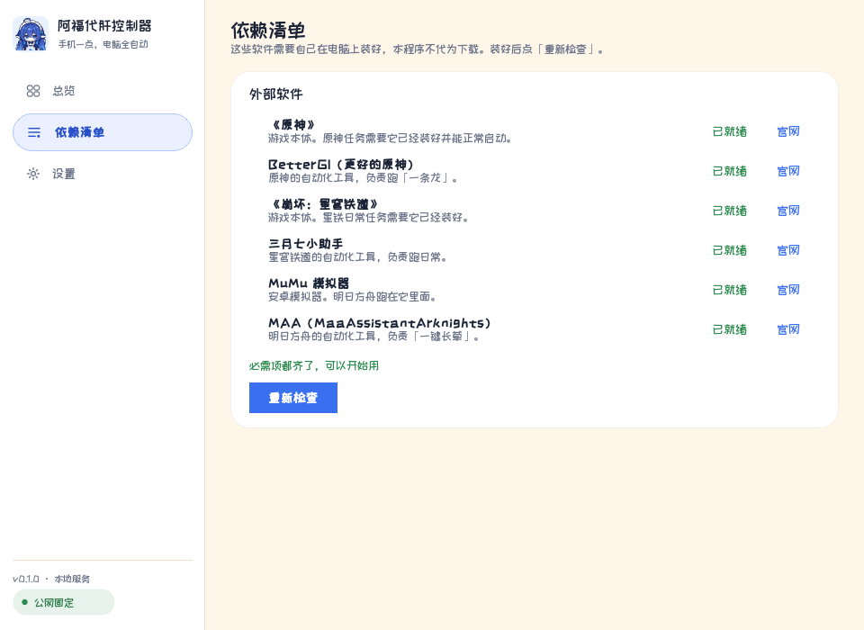
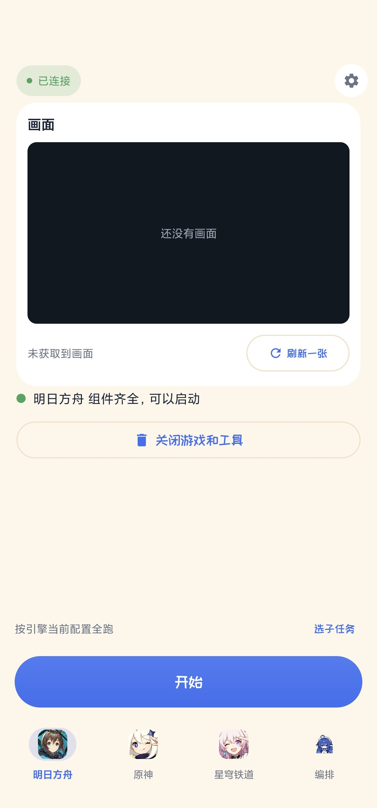
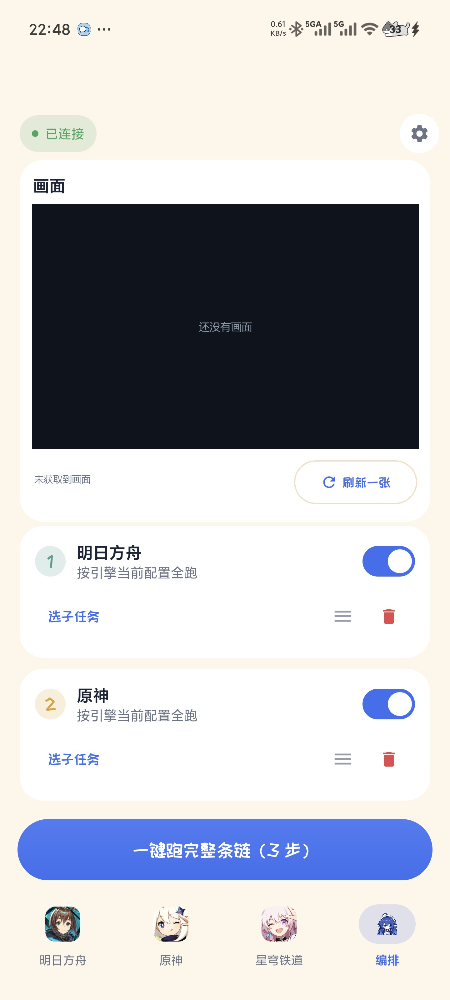
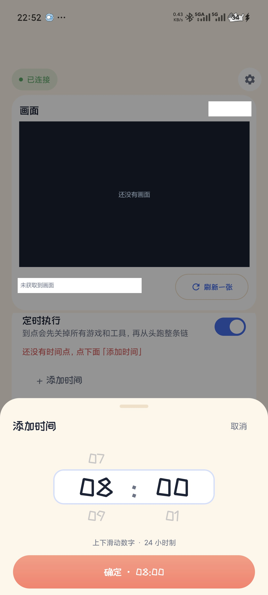

# 阿福代肝控制器

在手机上点一下，让电脑自动跑完三个游戏的日常。

- **明日方舟** —— 交给 [MAA](https://maa.plus/) 一键长草
- **原神** —— 交给 [BetterGI](https://www.bettergi.com/) 跑一条龙
- **崩坏：星穹铁道** —— 交给 [三月七小助手](https://m7a.top/) 跑日常

电脑端常驻一个小窗口，负责启动本地服务、显示手机要填的地址与配对码；
手机 APP（或浏览器）连上去就能看到游戏实时画面、点开始、点停止、编排任务链、设定时。

本程序只是「胶水」：真正干活的是上面三个成熟的开源工具，本仓库不包含它们的代码与素材。

<p>
  
  
</p>

<p>
  
  
  
</p>

> 截图中的地址为示例；手机端画面区为空画面状态，避免露出本机内容。

## 目录

- [它能做什么](#它能做什么)
- [使用前要准备什么](#使用前要准备什么)
- [快速开始](#快速开始)
- [手机怎么连上电脑](#手机怎么连上电脑)
- [详细图文教程](#详细图文教程)
- [架构](#架构)
- [构建](#构建)
- [常见问题](#常见问题)
- [已知边界](#已知边界)
- [许可证](#许可证)

## 它能做什么

### 一台电脑、一个手机

电脑端是个小窗口，负责：

- 启动/停止本地服务（服务只监听本机与局域网，不主动连外网）
- 显示「手机该填什么」：地址、配对码，支持一键复制
- 显示三个游戏各自是否可用（依赖的软件与游戏是否都探测到）

手机端是实际操作的界面：

- 看游戏实时画面（服务端截图，约每 20 秒刷新一张）
- 开始 / 停止当前游戏的自动化
- 三个游戏各自独立一页，底栏切换
- 设置里可以改连接地址、重新配对、断开连接

### 编排：把三个游戏串成一条链

可以按顺序编排「先跑方舟，再跑原神，最后跑星铁」，一键从头跑到尾；
某一步失败时，可以选择跳过继续，或中止整条链。

### 定时：到点自己跑

设定每天 / 每周几的若干个时间点，到点会：

1. 先关掉电脑上残留的游戏与工具进程（含模拟器）
2. 再从第 1 步开始，完整跑一遍编好的任务链

> 这一步会关掉正在运行的游戏 —— 如果此刻你在手动玩，也会被关掉。

错过的时点不会补跑；手机断网时改动会先存在本地，重连后自动同步。

## 使用前要准备什么

| 需要什么 | 用途 | 从哪拿 |
|---|---|---|
| Windows 10 / 11 | 运行电脑端与服务 | — |
| 明日方舟 + [MAA](https://maa.plus/) | 方舟自动化 | 官网下载 |
| [MuMu 模拟器](https://mumu.163.com/)（或其它安卓模拟器） | 方舟运行环境 | 官网下载 |
| 原神 + [BetterGI](https://www.bettergi.com/) | 原神自动化 | 官网下载 |
| 崩坏：星穹铁道 + [三月七小助手](https://m7a.top/) | 星铁日常 | 官网下载 |
| [Tailscale](https://tailscale.com/download/windows)（可选） | 出门在外也能连 | 官网下载 |

三个游戏不是必须全装：只装一款也能用，界面会写明另外几款缺什么。

## 快速开始

### 1. 电脑端

1. 下载并解压发布的压缩包，双击 `阿福代肝控制器.exe`
2. 首次运行会请求一次管理员权限（服务需要它来启动/结束游戏进程）
3. 窗口打开后，「总览」页会显示服务状态、手机要填的地址与配对码

### 2. 手机端

1. 安装 `app-release.apk`
2. 打开后进入「连接电脑」页
3. 填入电脑端显示的地址 → 连接 → 填入 6 位配对码 → 配对

配对码只能用一次，有效期 5 分钟；过期在电脑端点「换一个」重新生成。

### 3. 浏览器也能用

电脑端「设置」里点「打开网页控制台」，用浏览器就能看到同样的状态与配对码，
适合临时看一下、或者手机没装 APP 的时候。

## 手机怎么连上电脑

两种地址，按你的场景选一个：

| 方式 | 手机和电脑要在同一 WiFi 吗 | 地址长什么样 | 适合 |
|---|---|---|---|
| 局域网 | 要 | `192.168.x.x:8765` | 在家 |
| Tailscale Funnel | 不要 | `https://你的主机名.你的随机串.ts.net` | 在外面 |

### 拿到公网固定地址（推荐）

```
① 注册 Tailscale 账号（免费）→ https://login.tailscale.com/start
② 安装并登录（托盘图标 → Log in）
③ 管理员 PowerShell 执行一次：tailscale funnel --bg 8765
④ 浏览器点一次授权，Tailscale 就会给你一个固定网址
```

这个地址由**你自己的** Tailscale 账号生成，别人不通用；本程序会自动把它显示在
「总览」页的「填地址」那一步，点「复制地址」直接贴到手机上。

> 注意：Funnel 走的是 443 端口，手机上填 `https://xxx.ts.net` 就行，
> **不要**加 `:8765`，加了反而连不上。

## 详细图文教程

从零开始（装 MAA / 模拟器 / BetterGI / 三月七、配 Tailscale、装手机端、日常怎么用）
的完整版本见 **[docs/新手图文教程.md](docs/新手图文教程.md)**。

## 架构

```
desktop/   电脑端界面（PySide6）：侧边栏 + 卡片布局，后台线程做探测与查询
server/    本地服务（FastAPI）：任务生命周期、编排、定时、截图、鉴权与配对
android/   手机端（Compose）：实时画面、任务控制、编排与定时编辑
assets/    图标与字体（原创图形 + 开源字体）
docs/      教程与截图
```

服务端分层：`api/`（HTTP 与 WebSocket 契约）→ `core/`（状态机与编排）→
`engine/`（三个引擎的适配器）→ `platform/`（Windows 进程、截图、唤醒）。
依赖只能自上而下，任务状态只由 `core` 维护。

## 构建

### 电脑端

需要 Python 3.11+。

```bash
cd server
python -m venv .venv
.venv/Scripts/pip install -r requirements.txt
.venv/Scripts/python run.py          # 直接跑服务

cd ../desktop
python main.py                        # 跑界面（需要上面那份依赖）
```

打包成 exe（可选，需要 PyInstaller）：

```bash
pyinstaller desktop/阿福代肝控制器.spec
```

### 手机端

需要 JDK 17+、Android SDK（platform 35 / build-tools 35）。

```bash
export ANDROID_HOME=/path/to/Android/Sdk
export GRADLE_USER_HOME=/path/to/gradle-home   # 避免把缓存写进系统盘

cd android
./gradlew assembleRelease
adb install -r app/build/outputs/apk/release/app-release.apk
```

`release` 包默认用 debug keystore 签名，便于覆盖安装；正式分发请配置自己的 keystore。

## 常见问题

**手机连不上，一直转圈**
先确认电脑端窗口是「服务运行中」。然后看地址有没有填错：公网地址不要带 `:8765`。
局域网地址要求手机和电脑连同一个路由器，且电脑防火墙允许 8765 端口。

**配对码提示无效或过期**
配对码只能用一次、有效期 5 分钟。在电脑端「总览」页点「重新配对」换一个再填。

**按钮点不了，写着「缺少 XX」**
说明对应游戏或自动化工具没装好。点「依赖清单」页，那里有每一项的官网链接与安装位置说明。

**任务跑起来了但画面一直不动**
画面约 20 秒刷新一张，是「快照」而不是实时视频流。这是有意的：省流量、也省电脑性能。
点「刷新一张」可以立刻要一张新的。

**开了定时，电脑上正在玩的游戏被关掉了**
这是定时的设计：到点先清场再从头跑，避免上次残留的窗口/进程抢焦点。
不想被关就先关掉定时开关。

**杀毒软件报毒**
PyInstaller 打包的 exe 常被误报。可以把程序目录加入白名单，或直接从源码运行。

## 已知边界

- 只支持 Windows 电脑端（服务用到 Windows 的进程、窗口与截图接口）
- 画面是定时截图，不是视频流
- 定时错过的时间点不补跑（关机、休眠期间错过就算了）
- 三个游戏与工具都由用户自己安装，本程序不代为下载
- 自动化行为完全取决于 MAA / BetterGI / 三月七小助手，本程序只负责调度

## 许可证

[PolyForm Noncommercial License 1.0.0](LICENSE) —— 允许个人学习、研究与非商业使用，
不允许商业用途。分发时须保留 `LICENSE` 中的 Required Notice。

本仓库不包含任何游戏厂商的美术素材；三个游戏的应用图标在运行时从本机已安装的
游戏与工具中提取。第三方组件与字体的授权见 [THIRD-PARTY-NOTICES.md](THIRD-PARTY-NOTICES.md)。
