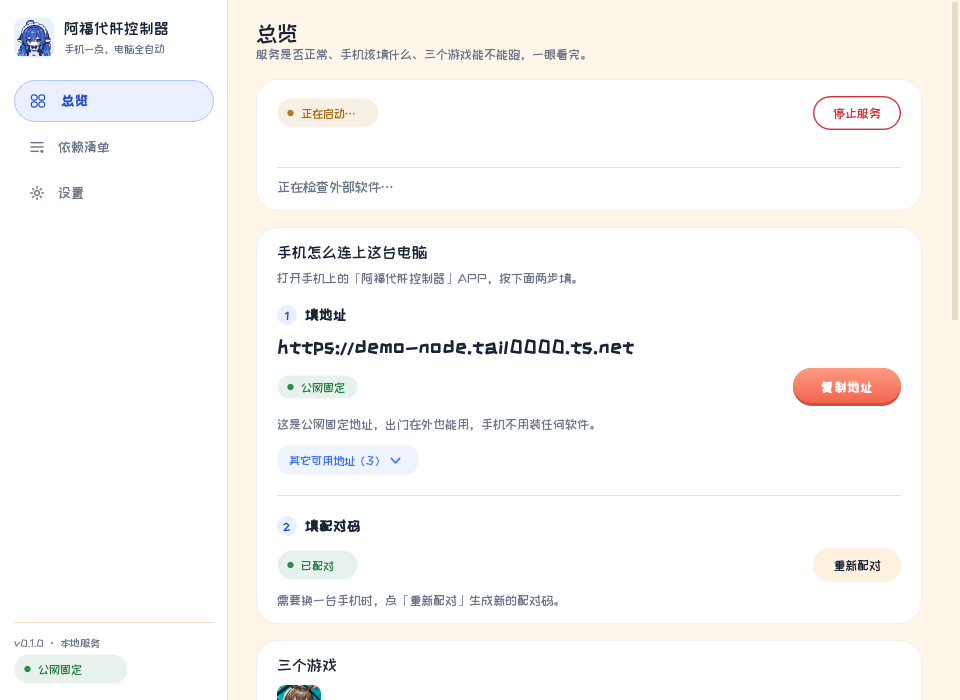
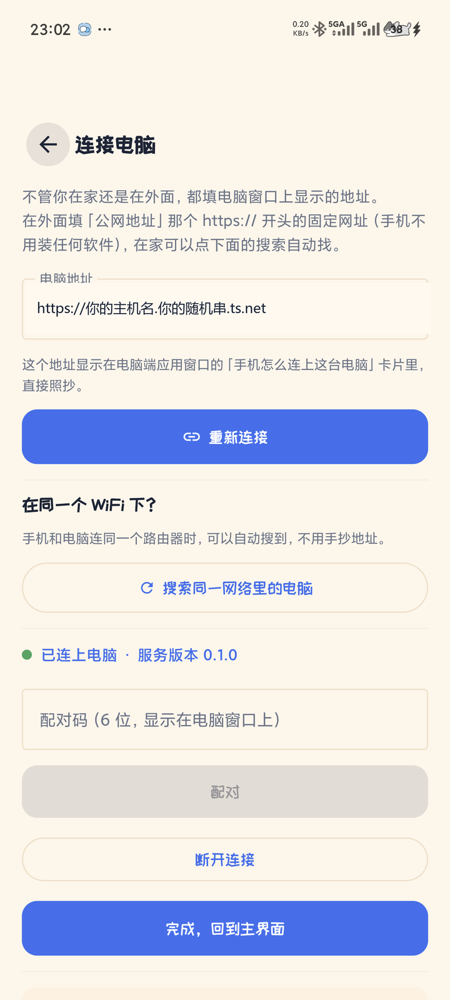
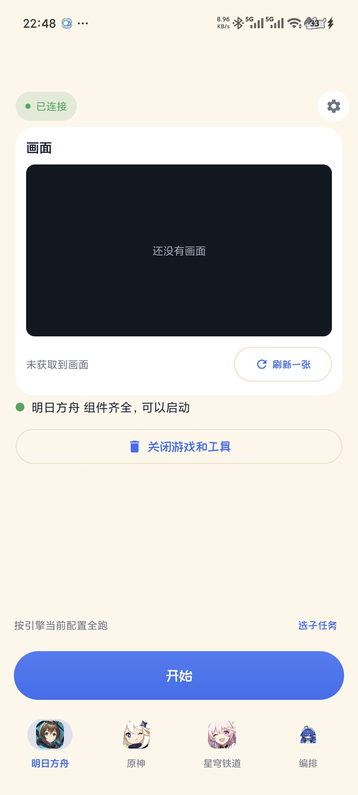

# 新手图文教程

> 这份文档带你从**零**走到「手机点一下，电脑自动跑完三个游戏的日常」。
>
> 全程大约 40 分钟，主要花在下载和装软件上。装的东西只用装一次。

---

## 开始之前：这份教程适合你吗？

### ✅ 适合你，如果你

- 玩《明日方舟》《原神》《崩坏：星穹铁道》中的**至少一个**
- 已经用过或者愿意用 **MAA / BetterGI / 三月七小助手** 这类自动化工具
- 想「人不在电脑前，也能让电脑把日常跑完」

### ❌ 不适合你，如果

- 你玩游戏只是偶尔上线看看 —— 装一堆工具不值得
- 你期待本程序**替你操作游戏** —— 不，本程序只是遥控器，
  真正干活的是 MAA / BetterGI / 三月七，本程序负责「让你能在手机上按开始」
- 你完全没接触过自动化工具 —— 能装，但**建议先单独把 MAA 用熟**再回来

### ⚠️ 必须知道的事

- **本程序不修改游戏、不读游戏内存**，只是把你的点击转给第三方工具
- **封号风险没有任何官方承诺**。风险请自己判断，用不用自己决定
- 本程序是**胶水**，它的能力上限 = 你装的三个工具的能力上限

---

## 你需要准备的（按你玩的游戏选）

| 你玩 | 必须装 | 大概耗时 |
|---|---|---|
| 只玩明日方舟 | MAA + MuMu 模拟器 + 游戏本体 | 20 分钟 |
| 只玩原神 | BetterGI + 游戏本体 | 10 分钟 |
| 只玩星铁 | 三月七小助手 + 游戏本体 | 10 分钟 |
| 三个都玩 | 上面全部 | 40 分钟 |

再加上：

| 用途 | 装什么 | 在哪装 |
|---|---|---|
| 让手机能在任何网络下连回电脑 | **Tailscale**（只装在电脑上） | <https://tailscale.com/download/windows> |
| 手机上遥控 | **阿福代肝控制器 APP** | 本项目 Releases |

---

## 第一步：装三个游戏自动化工具

> 这一步和本程序**没有任何关系**，全是第三方开源工具。
> 建议每个工具先单独跑通一次，确认它能正常操作游戏，再回来看本程序。

### 1-A 明日方舟 → MAA + MuMu

**装 MuMu 模拟器**

1. 打开 <https://mumu.163.com/download/> 下载安装
2. 装完后在模拟器里装《明日方舟》并登录
3. 记下模拟器的分辨率设置（MAA 需要匹配）


**装 MAA**

1. 打开 <https://maa.plus/> → 下载 Windows x64 版本
2. **解压到一个简单路径**，比如 `D:\MAA`。不要放 `C:\Program Files`（需要管理员权限会出错）
3. 先运行解压目录里的 `DependencySetup_依赖库安装.bat`（装 VC++ 运行库）
4. 双击 `MAA.exe`
5. 在 MAA 里添加你的明日方舟账号，连接 MuMu 模拟器
6. **手动点一次「开始唤醒」+ 跑一次日常**，确认能正常工作


> 🔑 **关键一步**：MAA 设置里要打开**远程控制**（设置 → 远程控制 → 记住端口，默认 8080）。
> 本程序靠它给 MAA 下发任务。

### 1-B 原神 → BetterGI

1. 打开 <https://www.bettergi.com/> 下载
2. 解压运行
3. 首次启动会让你选《原神》的游戏目录
4. **在 BetterGI 里手动跑一次「一条龙」**，确认能正常工作


### 1-C 星穹铁道 → 三月七小助手

1. 打开 <https://m7a.top/> 下载
2. 解压运行
3. 让它自动识别《崩坏：星穹铁道》的安装位置
4. **手动跑一次日常**，确认能正常工作


> 三月七第一次运行会把自己的安装路径写进
> `%LOCALAPPDATA%\March7thAssistant\installs.json`，
> 本程序靠这个文件找到它。

### 1-D 游戏本体

如果游戏还没装：

- 《原神》 <https://ys.mihoyo.com/>
- 《崩坏：星穹铁道》 <https://sr.mihoyo.com/>
- 《明日方舟》在 MuMu 模拟器里装（或者在手机应用商店装到模拟器里）

---

## 第二步：装 Tailscale（只装在电脑上）

**为什么要装**：让你出门在外时，手机也能连回家里的电脑。

**手机端不需要装** —— 这一点很重要，Tailscale 只装在电脑上。

### 2-A 注册账号

打开 <https://login.tailscale.com/start>，用下面任意一个账号登录：

- Google 账号
- GitHub 账号
- 微软账号

免费档够用（3 个用户、100 台设备）。


### 2-B 电脑安装并登录

1. 从 <https://tailscale.com/download/windows> 下载安装
2. 装完屏幕右下角托盘区会出现 Tailscale 图标（可能要点开 `^` 箭头才看到）
3. 点图标 →「**Log in**」
4. 浏览器会跳出来，点授权


### 2-C 开启 Funnel（拿到你的固定地址）

用**管理员身份**打开 PowerShell（开始菜单搜 PowerShell → 右键 → 以管理员身份运行），执行：

```powershell
tailscale funnel --bg 8765
```

第一次会弹浏览器让你**点一次授权**。完成后命令行会输出类似：

```
Available on the internet:
https://你的主机名.你的随机串.ts.net
|-- / proxy http://127.0.0.1:8765
```

**这一行就是你的固定地址。** 记住它的样子：

```
https://你的主机名.你的随机串.ts.net
         └──┬──┘ └───┬───┘ └─┬─┘
       你的电脑名  随机串   固定后缀
```

> ⚠️ `你的随机串` 这一段**每个人都不同**，是 Tailscale 注册时随机生成的。
> **不能照抄上面的例子**，你必须用自己电脑上输出的那个。
>
> 记不住也没关系 —— 本程序会自动读到并显示出来。

这一步**只需要做一次**。以后开机、重启，地址都不会变。


---

## 第三步：装阿福代肝控制器（电脑端）

1. 从本项目 Releases 下载 `阿福代肝控制器.zip`
2. 解压到任意位置（**不要**放 `C:\Program Files`）
3. 双击 `阿福代肝控制器.exe`
4. 弹出 UAC 权限请求 → **点「是」**（必须，否则无法模拟键鼠）

### 打开后你会看到



三块内容，从上往下看：

**① 服务**
- 绿点「服务运行中」= 正常
- 「✓ 运行所需的软件都装好了」= 第一步的软件它都找到了
- 如果这里显示「⚠ 还缺 XXX」，去左侧「依赖清单」看是哪个没装好

**② 手机怎么连上这台电脑**
- 「① 填地址」下面那行 `https://xxx.ts.net` —— **这就是你要填到手机里的**
- 旁边有「复制地址」按钮，点一下自动复制

**③ 公网固定地址（出门在外用这个）**
- 四步检查表：① 注册 ② 安装 ③ 登录 ④ 开启 Funnel
- 做完之后这里会显示你的固定网址，和上面那个地址是同一个

**④ 游戏状态**
- 三个游戏各显示「可用」或「缺 XXX」
- **只装了一款游戏也没关系**：三个都还在，没装的那几行会写清楚缺什么

### 第一次用建议走一遍引导

左侧导航 →「设置」→「**首次使用引导**」按钮，会打开一个浏览器页面，
把依赖、连接、配对完整讲一遍。

---

## 第四步：装 APP 并连上电脑

### 4-A 安装 APP

从本项目 Releases 下载 `阿福代肝控制器.apk`，装到手机上
（安卓会提示「未知来源应用」，允许即可）。

### 4-B 连接

> 连上以后想换电脑、重新配对、断开连接，都在 APP 右上角的**设置 → 连接设置**里，
> 每个游戏页底部不再有「连接设置」按钮——它是通用能力，和玩哪个游戏无关。

打开 APP，如果还没配对过，第一屏直接就是「连接电脑」页面：



**按两个步骤填：**

| 步骤 | 填什么 | 从哪来 |
|---|---|---|
| ① 电脑地址 | `https://你的主机名.你的随机串.ts.net` | 电脑端「总览」页的那个地址，点「复制地址」 |
| ② 配对码 | 6 位数字 | 电脑端「总览」页的「② 填配对码」 |

填完地址点「**连接**」，连上后填配对码，点「**配对**」。

连上后会显示：

```
● 已连上电脑 · 服务版本 0.1.0
```

### 4-C 如果你的电脑端显示「还拿不到地址」

说明第二步 2-C 没做完。电脑端「连接」页会显示出四步检查表：


哪一步是红的，就去做那一步。

---

## 第五步：用起来

连上之后，APP 主界面长这样：



- **底部三个图标**：切换 明日方舟 / 原神 / 星穹铁道
- **画面**：电脑屏幕的实时截图，任务在跑时会自动刷新
- **「开始XXX」按钮**：固定在底部，点一下就启动对应的一条龙
- **「关闭并释放内存」**：任务结束后把游戏和工具关掉（它们很吃内存）

### 常见操作

| 想做什么 | 怎么做 |
|---|---|
| 跑原神一条龙 | 底部点「原神」→「开始一条龙」 |
| 看任务跑到哪了 | 看画面区，或者往下看任务卡片的日志 |
| 中途停下 | 底部「停止任务」 |
| 换一台电脑 | 「连接设置」→ 填新地址 → 重新配对 |
| 释放内存 | 「关闭并释放内存」 |

### 一个提醒

任务跑完（成功/失败/超时）后，本程序会**自动关掉游戏和工具**来释放内存。
如果你是**手动点停止**的，不会自动清理——因为可能你还要接着玩。
需要清理时点「关闭并释放内存」。

---

## 出问题了怎么办

<details>
<summary>手机连不上电脑</summary>

**先确认电脑端是不是好的**：电脑浏览器打开 `https://你的地址.ts.net`，
能看到控制台页面 = 电脑端没问题，问题在手机或网络。

然后按地址类型排查：

- **填的是 `https://xxx.ts.net`**（公网固定地址）
  1. 电脑上的「阿福代肝控制器」在运行吗
  2. 管理员 PowerShell 执行 `tailscale funnel status`，看到 `Funnel on` 吗
  3. **地址不要加端口号**，Funnel 走 443

- **填的是 `192.168.x.x:8765`**（局域网）
  只能在同一个 WiFi 下用，出门不管用

- **填的是 `100.x.x.x:8765`**（Tailscale 私有地址）
  需要手机也装 Tailscale 并登录同一账号

</details>

<details>
<summary>显示「缺少 MAA」「缺少 BetterGI」</summary>

去电脑端「依赖清单」页看，每项都标了「已就绪」或「未安装」，
未安装的旁边有「官网」链接。

装好之后点「重新检查」。

如果明明装了却显示未安装，可能是装在特殊位置 —— 那是自动探测没找到，
可以在依赖清单页手动指定路径。

</details>

<details>
<summary>点「开始」没反应 / 提示锁屏</summary>

本程序运行期间会阻止电脑自动锁屏。但如果你**手动按了 Win+L**，
它不会也不能替你解锁 —— 需要先在电脑上解锁。

</details>

<details>
<summary>任务跑完内存爆了</summary>

任务正常结束会自动清理。如果你是手动停的，点「关闭并释放内存」。
也可以在电脑端设置里关掉自动清理（如果你希望任务结束后保留游戏）。

</details>

<details>
<summary>双击 exe 提示「已经在运行了」</summary>

它没关掉，只是窗口被最小化或者在别的窗口后面：

1. 按 **Alt + Tab** 切换过去
2. 或者看屏幕右下角**托盘区**（可能要点开 `^` 箭头）
3. 实在找不到：任务管理器 → 找到「阿福代肝控制器」→ 结束任务 → 重新双击

</details>

<details>
<summary>网页打不开 / 白屏</summary>

旧版本有这个 bug（文档页依赖境外 CDN）。现在资源全部随程序分发，断网也能打开。
点电脑端「打开网页控制台」应该能看到控制台。

</details>

---

## 完整清单（打勾用）

```
□ 装 MAA（如果要玩方舟）
□ 装 MuMu 模拟器（如果要玩方舟）
□ 在 MuMu 里装明日方舟并登录
□ 装 BetterGI（如果要玩原神）
□ 装三月七小助手（如果要玩星铁）
□ 装游戏本体
□ 每个工具都单独跑通一次
□ MAA 开启「远程控制」
□ 注册 Tailscale 账号
□ 电脑装 Tailscale 并登录
□ 管理员 PowerShell 执行 tailscale funnel --bg 8765
□ 记下你的固定地址 https://xxx.ts.net
□ 解压阿福代肝控制器.exe 并双击运行（UAC 点「是」）
□ 确认总览页显示「✓ 运行所需的软件都装好了」
□ 手机装 APP
□ 在 APP 里填地址 + 配对码
□ 点一次「开始」确认能跑
```

全部打勾，你就完成了。
